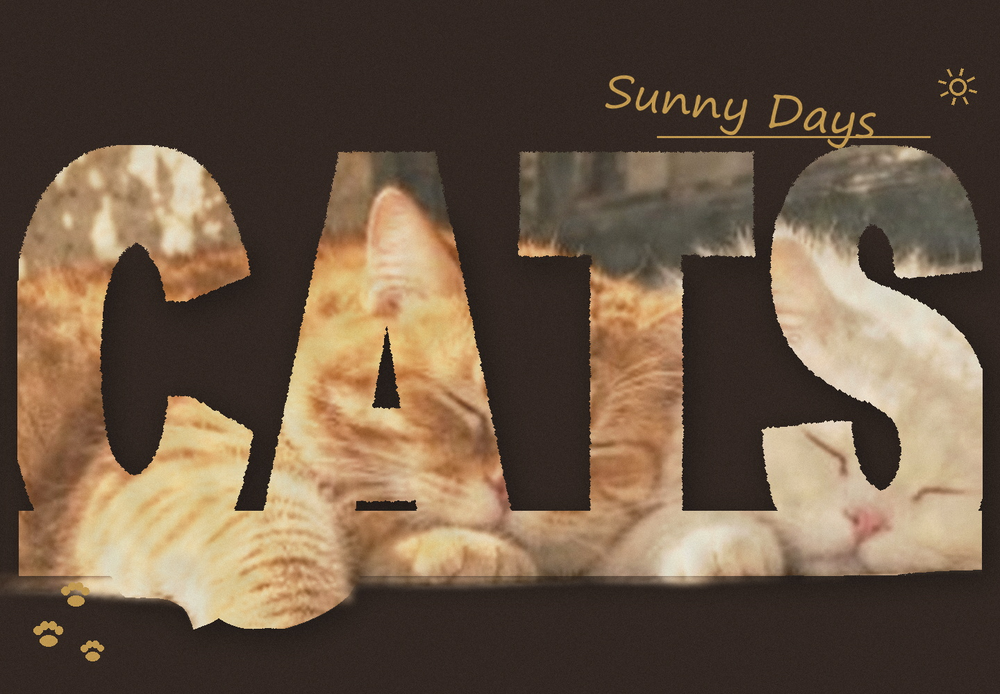

# photo-letter-window · 照片字母窗海报

把一张照片塞进超粗的大写单词里：**字母的笔画内部就是照片**，主体（猫、鞋头、爪、花）还能越过字边伸出来，做成一张复古印刷质感的海报。

> 一张图进，一张海报出。文字绝不拼错（程序排版，不是 AI 生成）。



---

## 一、它能做什么

| | 路径 A · AI 一次成图 | 路径 B · 程序合成（本技能主体） |
|---|---|---|
| 适用 | 要"效果炸"、主体轮廓随意探出 | 要"就是这张原图"、要印刷、文字不许错 |
| 照片 | 会被模型重绘 | 一个像素不动 |
| 文字 | 可能拼错 | 绝不拼错 |
| 怎么走 | 出提示词 → 丢给图像模型 | 一条命令直接出图 |

本仓库提供**两条路**：

- `references/prompt-master.md`：中文/英文提示词模板，可直接喂给豆包、即梦、Midjourney、ImageGen 等；
- `scripts/letterkit.py`：本地合成脚本，PIL + 可选 rembg，输出 1440×1000 或自定义尺寸。

---

## 二、安装

### 方式 1：作为 WorkBuddy 技能安装（推荐）

把整个文件夹放进技能目录，重启 WorkBuddy 即可被识别：

| 系统 | 目标路径 |
|---|---|
| Windows | `C:\Users\<你的用户名>\.workbuddy\skills\photo-letter-window\` |
| macOS / Linux | `~/.workbuddy/skills/photo-letter-window/` |

放好之后，直接跟 AI 说「用 photo-letter-window 把这张照片做成字母海报」即可，它会读 `SKILL.md` 里的流程自己跑。

### 方式 2：不装技能，当普通脚本用

只要 Python 3.9+ 就行，不需要 WorkBuddy：

```bash
python scripts/letterkit.py poster 你的照片.jpg --word CATS -o 海报.jpg
```

### 依赖

```bash
pip install pillow numpy scipy      # 必需（numpy/scipy 用于溢出判定与做旧）
pip install rembg onnxruntime       # 可选，装了才有"主体伸出字边"的立体效果
```

- **Pillow**：必需，缺了直接报错。
- **numpy + scipy**：强烈建议装。缺了会退回较慢/较弱的老算法，立体感和做旧都会打折。
- **rembg**：可选。不装也能出图，只是没有抠图，字外不会伸出爪子。首次运行会自动下载 u2net 模型（约 170MB），需要联网。

### 字体

脚本自动从系统里找，找不到时用 `--font 路径.ttf` 指定。

- Windows：Arial Black（`ariblk.ttf`）、Segoe Print、Bahnschrift 一般都有；
- macOS：Arial Black、Bradley Hand 在 `/System/Library/Fonts/Supplemental/` 下；
- Linux：建议先 `apt install fonts-dejavu`，或自己下个 Arial Black 丢进字体目录。

---

## 三、三步出图

```bash
# 0) 预处理：统正方向、转 RGB、长边压到 2048
python scripts/letterkit.py prep 原图.jpg -o out/photo_clean.jpg

# 1) 体检（可选）：给出底色/强调色建议，以及这张图适不适合做
python scripts/letterkit.py analyze out/photo_clean.jpg

# 2) 出图
python scripts/letterkit.py poster out/photo_clean.jpg \
  --word CATS --bg "#2A1E18" \
  --tag "Sunny Days" --tag-color "200,155,74" --tag-orn sun --tag-rule \
  --marks paw \
  -o out/poster.jpg
```

默认输出 **1440×1000（1.44:1）**，词占宽 96%、占高约 60%，下方留白给"爪子垂下来"。

---

## 四、常用参数

| 参数 | 作用 | 建议 |
|---|---|---|
| `--word` | 单词（全大写，3–4 个字母最好） | `CATS` `RUN` `BREW` `ACE` |
| `--bg` | 底色 | 深色更稳，如 `#2A1E18` `#1E1814` `#20303A` |
| `--size` | 画布 | 默认 `1440x1000`；竖版老版式用 `1152x1536` |
| `--mode` | `glyph` / `band` / `window` | 默认 `glyph`（字母即照片）；`band` 是上下分栏老版式 |
| `--tag` | 右上角手写标语 | 两个词最稳，如 `Sunny Days` |
| `--tag-orn` | 标语旁小装饰 | `sun` / `paw` / `none` |
| `--tag-rule` | 标语下细横线 | 开着更像成品 |
| `--marks` | 角落印记 | `paw`（三枚爪印）/ `dot` / `none` |
| `--spill` | 主体越出字边的半径（相对字高） | 默认 0.14；想要整只爪子垂下来给 0.22 |
| `--extra` | 字外补图深度（相对字高） | 默认 0.07；0 = 字外纯底色 |
| `--distress` | 复古做旧强度 0–1 | 默认 0.75 |
| `--font` | 指定字体文件 | 系统字体不满意时用 |

完整参数见 `SKILL.md` 的参数表，调参踩坑记录见 `references/diagnose.md`。

---

## 五、常见问题

**Q：字太细，看起来像"黑字压在照片上"？**
A：这是最容易踩的坑。裁一个字母放大看——两条笔画里是毛、字腔是深色，说明对了；如果整块都是黑的，就是字太细。把 `--weight-pct` 加到 0.01~0.02，或换更重的字体。

**Q：字母外面没有伸出爪子？**
A：三个原因：① 没装 rembg；② 照片里主体没有"能独立伸出的部件"（整片毯子、草莓堆这类不行）；③ 主体没落地——脚本默认会把主体"落地线"对齐到字的基线，主体悬空时这一步会自动跳过。

**Q：字外的照片像一条光晕/一条横带？**
A：把 `--extra` 降到 0.05 以下，或直接 `--extra 0`。

**Q：报错 `找不到可用字体`？**
A：`--font` 指定一个 `.ttf`，Windows 上 Arial Black 在 `C:\Windows\Fonts\ariblk.ttf`。

**Q：能出中文吗？**
A：不能。中文挤进这个版式会糊成一团，图像模型渲染中文也几乎必崩。单词只能用英文全大写。

---

## 六、目录结构

```
photo-letter-window/
├── SKILL.md                  # 技能主文件：流程、参数、原理、踩坑记录
├── README.md                 # 本文件
├── scripts/
│   └── letterkit.py          # 全部实现：prep / analyze / palette / poster
├── references/
│   ├── prompt-master.md      # 提示词模板（中文标准版 / 分栏版 / 英文版）
│   ├── diagnose.md           # 诊断手册：看照片、选词、九条自检、参数速查
│   ├── examples.md           # 实测记录与调参踩坑（含量化数据）
│   └── article-original.md   # 原始出处存档与说明
└── examples/
    └── sample-cats.jpg       # 示例成片
```

---

## 七、出处与授权

- 玩法源自微信公众号「错觉幻视」《把照片塞进大字里做海报提示词》，文中提到的灵感来自 X 用户 @AWENIAI，详见 `references/article-original.md`。
- 本仓库的脚本、流程文档与提示词模板为二次整理与工程实现。
- 代码以 MIT 协议开源，可自由使用与修改；示例照片仅作演示，请勿商用。
